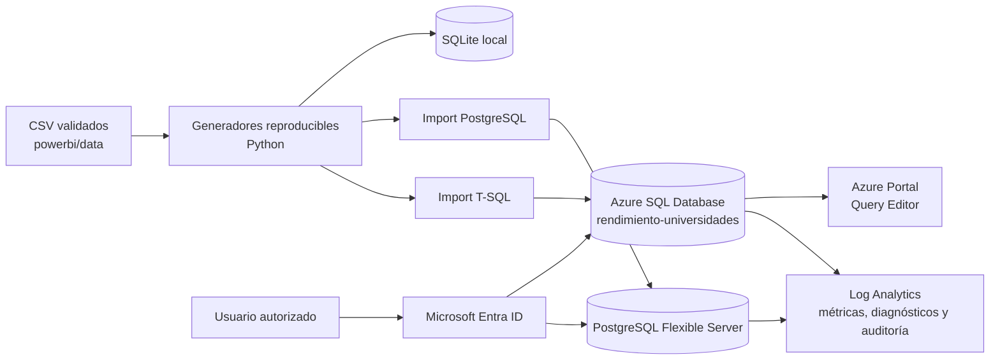

# Rendimiento-Universidades

Proyecto final de Herramientas Computacionales: ETL, modelo de datos, EDA y
medidas DAX para Power BI.

El proyecto conserva el análisis exploratorio de xAPI-Edu-Data y añade un
complemento oficial de la Universidad Nacional de Colombia, sede Medellín. Las
dos familias de datos se mantienen separadas porque describen poblaciones,
periodos y niveles de detalle distintos.

## Estado de los requerimientos

1. **ETL, modelo y EDA:** implementados para xAPI y para las fuentes oficiales.
2. **Promedio de notas por materia y semestre:** preparado con 1.977 registros
   oficiales de asignatura-periodo, correspondientes a 2015-2 y 2017-1.
3. **Deserción por facultad:** preparada con cinco facultades y dos cohortes
   institucionales, 2005-2 y 2006-1, observadas diez semestres después.
4. **DAX:** se incluyen medidas con COUNT, SUM, AVERAGE y CALCULATE para xAPI,
   y medidas de promedio publicado y tasa de deserción para el complemento.

La preparación de datos está terminada y verificada. Falta cargar las tablas y
medidas oficiales en el archivo de Power BI existente y construir las dos
páginas indicadas en [FUENTES_OFICIALES.md](powerbi/FUENTES_OFICIALES.md).

## Reproducir el ETL

Instalar dependencias y generar todos los CSV:

~~~powershell
python -m pip install -r requirements.txt
python etl/prepare_xapi.py
python etl/preparar_fuentes_oficiales.py
~~~

Para volver a descargar los tres PDF desde los sitios oficiales:

~~~powershell
python etl/preparar_fuentes_oficiales.py --descargar
~~~

Los resultados se escriben en powerbi/data. Las consultas M listas para copiar
en Power Query están en [consultas_oficiales](powerbi/consultas_oficiales/) y
las medidas están en [medidas.dax](powerbi/medidas.dax) y
[medidas_oficiales.dax](powerbi/medidas_oficiales.dax).

## Fuentes oficiales seleccionadas

- [Rendimiento académico UNAL Medellín 2015-2](https://planeacion.medellin.unal.edu.co/images/01%20Contenido%20Articulos/Estadisticas/Rendimiento%20Academico/InfRa2015-2.pdf)
- [Rendimiento académico UNAL Medellín 2017-1](https://planeacion.medellin.unal.edu.co/images/01%20Contenido%20Articulos/Estadisticas/Rendimiento%20Academico/InfRa2017-1.pdf)
- [Boletín estadístico UNAL Medellín 2010](https://planeacion.medellin.unal.edu.co/images/01%20Contenido%20Articulos/Estadisticas/Boletines/boletin2010.pdf)

Esta combinación es la más adecuada porque los informes de notas publican
promedio, inscritos, aprobados y reprobados por asignatura y periodo, mientras
el boletín publica matriculados iniciales, rezago, graduados y desertores netos
por facultad y cohorte. SNIES/SPADIES es una fuente oficial pertinente para
permanencia, pero sus bases públicas no resuelven el promedio de notas por
asignatura.

## Límites de interpretación

Los datos oficiales son históricos y agregados. No se pueden unir alumno por
alumno con las 480 observaciones de xAPI, ni sirven para atribuir causalidad
entre rendimiento y deserción. Los 63 promedios publicados como 0,00 quedan
marcados para revisión del tipo de calificación y se excluyen del campo usado
para análisis; el valor original permanece intacto.

La medida de notas muestra el promedio que publicó la universidad en cada
asignatura-periodo. No calcula un promedio global de promedios. La deserción
usa la definición neta por cohorte del boletín de 2010, no la metodología anual
vigente de SPADIES.

Más detalle sobre el modelo, las relaciones, los controles y los valores de
comprobación está en [FUENTES_OFICIALES.md](powerbi/FUENTES_OFICIALES.md).

## Bases de datos

El directorio [database](database/) contiene versiones reproducibles para
SQLite, PostgreSQL y Azure SQL Database, junto con scripts de construcción,
validación, despliegue y consultas. La base SQLite se puede abrir directamente
con DB Browser for SQLite; los archivos SQL permiten reproducir el mismo modelo
relacional en la nube sin almacenar credenciales en el repositorio.

## Arquitectura cloud en Azure

La solución se desplegó en el grupo de recursos
`rg-rendimiento-universidades-dev`. Azure SQL Database es el destino principal
para exploración desde el Query Editor del portal. El servidor PostgreSQL
Flexible Server conserva una implementación paralela del mismo modelo para
portabilidad y comparación entre motores.

### Componentes desplegados

| Componente | Configuración implementada | Función |
| --- | --- | --- |
| Azure SQL logical server | `sql-rendimiento-ucc-ce1209`, Central US | Aloja la base consultable desde Azure Portal. |
| Azure SQL Database | `rendimiento-universidades`, General Purpose serverless Gen5 | Modelo relacional principal con 10 tablas y una vista. |
| PostgreSQL Flexible Server | `psql-rendimiento-ucc-ce1209-cus`, PostgreSQL 18, Burstable B1ms | Implementación PostgreSQL paralela y portable. |
| Log Analytics | `log-rendimiento-ucc-ce1209`, retención de 30 días | Centraliza diagnósticos, métricas y auditoría. |
| SQLite | `database/rendimiento.sqlite3` | Exploración local con DB Browser for SQLite. |

Azure SQL usa el límite mensual gratuito, pausa automática tras 60 minutos sin
actividad y comportamiento `AutoPause` al agotar el límite gratuito. Su tamaño
máximo configurado es 32 GiB. PostgreSQL usa 32 GiB con crecimiento automático
y retención de respaldo de siete días. PostgreSQL es un recurso de pago aunque
Azure SQL permanezca dentro de su límite gratuito.

### Seguridad

- Los dos motores cloud usan autenticación exclusiva con Microsoft Entra ID;
  la autenticación por contraseña está deshabilitada.
- Los endpoints públicos están protegidos por reglas de firewall `/32`, limitadas
  a la IP del cliente de despliegue. No se habilitó acceso público global.
- Las conexiones de carga y validación comprueban el certificado y el nombre del
  servidor. PostgreSQL negoció TLS 1.3 y Azure SQL mantiene TLS 1.2 como mínimo.
- Azure SQL tiene Transparent Data Encryption habilitado. El cifrado del
  almacenamiento de PostgreSQL es administrado por el servicio.
- Los scripts solicitan tokens Entra de corta duración mediante Azure CLI y no
  guardan contraseñas, tokens, identificadores de suscripción ni claves privadas.
- El rol `rendimiento_reader` proporciona permisos de solo lectura sobre el
  esquema analítico para futuras identidades de consulta.

### Modelo y flujo de datos

Los CSV validados en `powerbi/data` son la fuente de verdad. Los generadores del
directorio `database` producen los artefactos SQLite, PostgreSQL y Azure SQL sin
alterar las fuentes. Las cargas crean el esquema `rendimiento`, siete dimensiones,
tres tablas de hechos, claves primarias y foráneas, restricciones de dominio,
índices y la vista `EDA_TemaSemestreRendimiento`.

Las poblaciones se mantienen separadas:

- `HechosObservaciones`: 480 observaciones xAPI.
- `HechosNotasOficiales`: 1.977 registros oficiales de asignatura-periodo.
- `HechosDesercionOficial`: 10 registros de facultad-cohorte.

Los 63 promedios publicados como cero permanecen intactos en el campo original y
se representan como `NULL` en el campo destinado al análisis.

### Observabilidad y control de costos

Azure SQL envía métricas básicas y avanzadas, estadísticas de consultas, errores,
bloqueos, interbloqueos, esperas y operaciones DevOps a Log Analytics. Su política
de auditoría también está habilitada. PostgreSQL envía todos sus registros y
métricas al mismo workspace. La retención es de 30 días y la ingestión está
limitada a 0,1 GB diarios para controlar costos.

### Validación y reproducción

La validación compara todos los campos y multiplicidades con los CSV, confirma
la vista EDA, las huellas de las fuentes y los totales publicados. Azure SQL tiene
10 claves primarias, 9 claves foráneas y 46 restricciones `CHECK`; además rechazó
11 mutaciones inválidas ejecutadas dentro de transacciones revertidas.

Para regenerar y verificar los artefactos locales:

~~~powershell
python database/build_database.py
python database/build_azure_sql.py
python database/fact_check.py
~~~

Las instrucciones de despliegue, verificación remota y consultas listas para el
Query Editor están en [database/README.md](database/README.md) y
[database/consultas_azure_sql.md](database/consultas_azure_sql.md).
